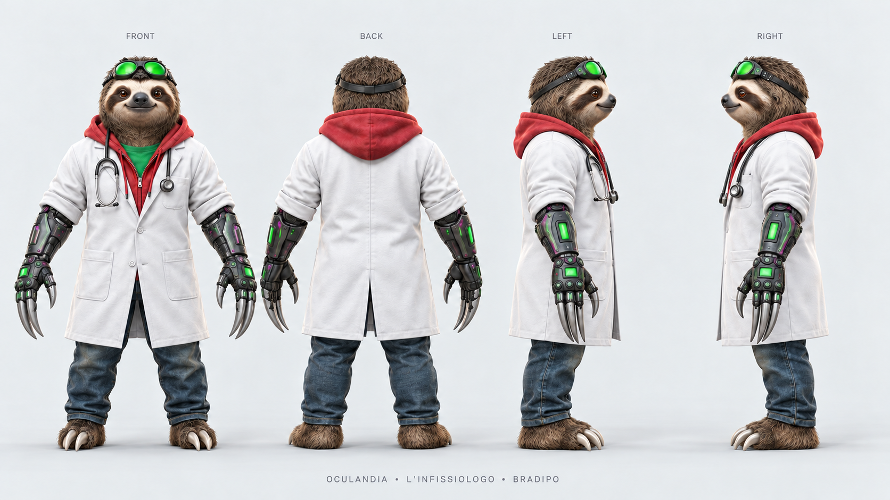

# FunAvatar

FunAvatar supports four avatar workflows in Codex and Claude Code: consistent **2D concept/reference art**, **tracked 3D production through Tripo**, **inspection of a supplied Blender or Unity project**, and **debugging concrete VRChat avatar defects**. It combines a reusable skill, compact native collectors and an offline helper.

A concept sheet is modeling guidance. A static report is inspection evidence. SDK validation, a successful build and observed client behavior each need their own checks. A completed Tripo task does not certify a rig or VRChat behavior, and FunAvatar does not upload an avatar automatically.

## Install or update

Requires Python 3.10+. Installation and the offline helper use the standard library and need no API keys or background services.

```sh
git clone https://github.com/xcapsa/FunAvatar.git
cd FunAvatar
python3 install.py --target both
```

The installer copies the skill to `~/.agents/skills/funavatar` for Codex and `~/.claude/skills/funavatar` for Claude Code. Existing installations are preserved unless an update is requested:

```sh
python3 install.py --target both --update
```

Updates verify managed file hashes, recognize the original v0.1 installation, and refuse modified, unknown or untracked files and symlinks. Both targets are staged before replacement; if either replacement fails, both are rolled back. Backups remain outside skill discovery at `~/.local/share/funavatar/backups`. To uninstall, remove the corresponding installed `funavatar` folder. Installation changes no application settings.

These discovery locations follow the [Codex skill guide](https://learn.chatgpt.com/docs/build-skills) and [Claude Code skill guide](https://code.claude.com/docs/en/skills). Cowork and cloud sessions use account-enabled skills; the portable `funavatar-skill.zip` can be uploaded manually where supported. Native collectors require their respective application and an authorized project.

## Use

Invoke `$funavatar` in Codex or `/funavatar` in Claude Code. Start a new session if the skill does not appear.

> Use FunAvatar to create an Oculandia scientist from my reference: white coat, red hoodie and green goggles, transforming into a sloth. Preserve identity and outfit. Produce separate human, transformed and detail sheets. Use bounded design and modeling reviews where useful. Remove Odido branding.

> Use FunAvatar to inspect my supplied avatar project and debug a toggle that works locally but not for other players. Reuse the existing setup, preserve unrelated work, and report local, mirror and remote proof separately.

Codex uses its built-in image generator when available. Claude uses an available connected image tool; without one, FunAvatar prepares the brief and prompts and says generation remains pending. It does not install a provider or spend credits to conceal that limitation. Oculandia branding is opt-in through the brief.

The skill adapts the smallest-complete-change principle from Dietrich Gebert's [Ponytail](https://github.com/DietrichGebert/ponytail/blob/main/skills/ponytail/SKILL.md): inspect the project, reuse working components, prefer native features and compatible installed tools, then add a small fix if needed. It installs no global Ponytail hooks or settings and preserves validation.

## Try the 3D preview without spending credits

The 3D route adds a local `workflow.json` ledger, an optional Tripo API adapter, resumable task queries, revision hashes and per-job credit reservations. Installing the skill and preparing a plan do not consume Tripo credits. Read the [3D workflow](skills/funavatar/references/workflow-3d.md) for commands, recovery and accounting rules.

Use Python 3.10+ on **macOS or Linux** for the Tripo workflow. It uses Unix `fcntl` process locks; native Windows is unsupported. A Windows user may use a suitable Linux environment only when their host can execute the helper there. The offline concept helper and skill text are separate from this restriction.

For this preview branch, clone and select it before installation:

```sh
git clone --branch codex/tripo-3d-trial https://github.com/xcapsa/FunAvatar.git
cd FunAvatar
python3 install.py --target claude
```

Use `--target codex` for Codex or `--target both` for both hosts. For an existing unchanged installation, add `--update`; the installer refuses to replace local customizations. Start a new session, then invoke `/funavatar` in Claude Code or `$funavatar` in Codex with:

> Facciamo una prova 3D con FunAvatar. Verifica prima il collegamento Tripo tramite una richiesta di sola lettura al saldo API. Prepara una singola generazione di un esploratore stilizzato in posa A, senza accessori sottili. Mostrami modello/versione, opzioni, costo previsto in crediti, fonte e data del prezzo, limite proposto e saldo disponibile. Non caricare file e non inviare generazioni finché non approvo esplicitamente il costo e il budget. Se mancano accesso o credenziali, dimmelo e prepara solo il necessario in locale. Dopo l'approvazione salva il task ID; se interrompiamo, riprendi lo stesso job senza inviarne un altro. Dimmi separatamente quali controlli sul modello e su VRChat restano da fare.

Configure `TRIPO_API_KEY` privately in the helper's execution environment. Do not paste the key into a chat, public issue, payload, command argument or ledger. A Tripo Studio subscription does not establish API credit access. The API account balance is separate from the budget authorized for this workflow.

Check [current official API pricing](https://developers.tripo3d.ai/en/pricing) for the selected model/options before approving a cost. The helper records a reviewed estimate/ceiling; it does not receive a provider price quote or impose a provider-side maximum charge. Unknown or uncertain costs stay reserved. Ambiguous submissions and detected overruns block new submissions. A successful read-only connection check does not establish that a paid generation or its exported model works.

Claude Cowork and cloud hosts need a manual portable-skill import where supported; installing into `~/.claude/skills` applies to Claude Code. A portable archive can supply the instructions, but the 3D commands still need Python, Unix locking, network access and a private way to provide the API key. Do not promise the same execution capability in every host. The published v0.2.0 archive predates this preview and has no Tripo job adapter.

For feedback, report your OS/host, selected operation and model, expected result, actual result and which stage stopped. Share the task ID or sanitized cost evidence only when appropriate; exclude API keys, personal account data, local private paths and model files you have not chosen to share.

## Offline helper and native reports

Create a brief and prompts:

```sh
python3 skills/funavatar/scripts/funavatar.py plan \
  --name "L'Infissiologo" \
  --idea "Scientist with white coat, red hoodie, green goggles and two drills" \
  --transformation sloth --brand Oculandia --out output/infissiologo
```

Repeat `--reference path/to/image.jpg` for reference images. `plan` preserves existing targets and does not generate images. Inspect image container/header structure, dimensions and SHA-256 with:

```sh
python3 skills/funavatar/scripts/funavatar.py check \
  examples/infissiologo/human-turnaround.png --min-long-edge 1536
```

For a supplied project, collect only the observations needed:

- Blender: run `skills/funavatar/scripts/blender_report.py` with Blender against the relevant `.blend` scene/root; it writes JSON without saving the source model.
- Unity: copy `skills/funavatar/assets/unity/Editor/FunAvatarReport.cs` into the authorized project's `Assets/Editor/`, select its avatar root and use **Tools → FunAvatar → Export selected avatar observations**.

See [project checks](skills/funavatar/references/project-checks.md) for exact collector commands, scope and limitations. Then inspect reports or create an unexecuted checklist:

```sh
python3 skills/funavatar/scripts/funavatar.py project-check \
  output/blender-report.json output/unity-report.json --out output/project-check.json
python3 skills/funavatar/scripts/funavatar.py debug-plan \
  --symptom remote --platform both --out output/remote-debug
```

`project-check` accepts Blender/Unity reports and emits bounded static findings. A clean result still leaves runtime and reference fidelity unverified. `debug-plan` supports `effects`, `remote`, `mobile`, `deformation`, `pixelation`, `motion` and `fidelity`, writing JSON and Markdown with every check initially unexecuted. Existing output targets are preserved. The [runtime debug guide](skills/funavatar/references/runtime-debug.md) covers targeted reproduction, fixes and client proof.

Image-to-3D work has a [fidelity gate](skills/funavatar/references/technical-handoff.md#image-to-3d-fidelity-gate) before rigging/effects: use provider-compatible isolated inputs, compare the actual model's silhouette and defining details with the approved reference, and measure height in engine units. A [Tripo profile](skills/funavatar/references/tripo.md) covers the user's Studio workflow, including HD Model versus Smart Mesh, retopology and export checks. Paid-plan access does not establish quality or justify using an entire decorative reference board as single-image input.

## Compatibility and verification limits

[VRChat's current Unity page](https://creators.vrchat.com/sdk/upgrade/current-unity-version/) specified **2022.3.22f1** when checked on 2026-10-11. Recheck before future project work. A newer installed editor does not prove VRChat support; do not migrate an avatar project to run a collector.

No 3D model or Unity avatar project was supplied for this release's development checks. The development machine had Unity 6000.6 and no available Blender runtime. The C# collector compiled against the installed Unity assemblies; starting the Editor was blocked by an inactive license. Blender collector tests use an offline fixture. These checks do not certify execution in Unity 2022.3 or a real supported VRChat project, deformation, effect synchronization, PhysBones or native Android behavior. Those require the actual asset, SDK and relevant client/device tests.

## Included example

[L'Infissiologo](examples/infissiologo/) is an Oculandia human character with a sloth transformation. It includes separate full-resolution sheets, prompts and review notes. Original source references and personal local paths are excluded.



The body sheets are 1672 × 941 and the detail sheet is 1536 × 1024; no upscaling was used. Published packages and sheets are available from [Releases](https://github.com/xcapsa/FunAvatar/releases/latest).

## Development

```sh
python3 -m unittest discover -s tests -v
```

Keep the entrypoint short and references on demand. Use relevant reports/diffs, reuse unchanged artifacts by hash, and delegate bounded independent checks when useful. These choices avoid duplicate work; they do not enforce a token budget or guarantee savings. Project experience cards retain source, versions, platform, preconditions, fix, proof and limitations within the user's authorized project scope.
