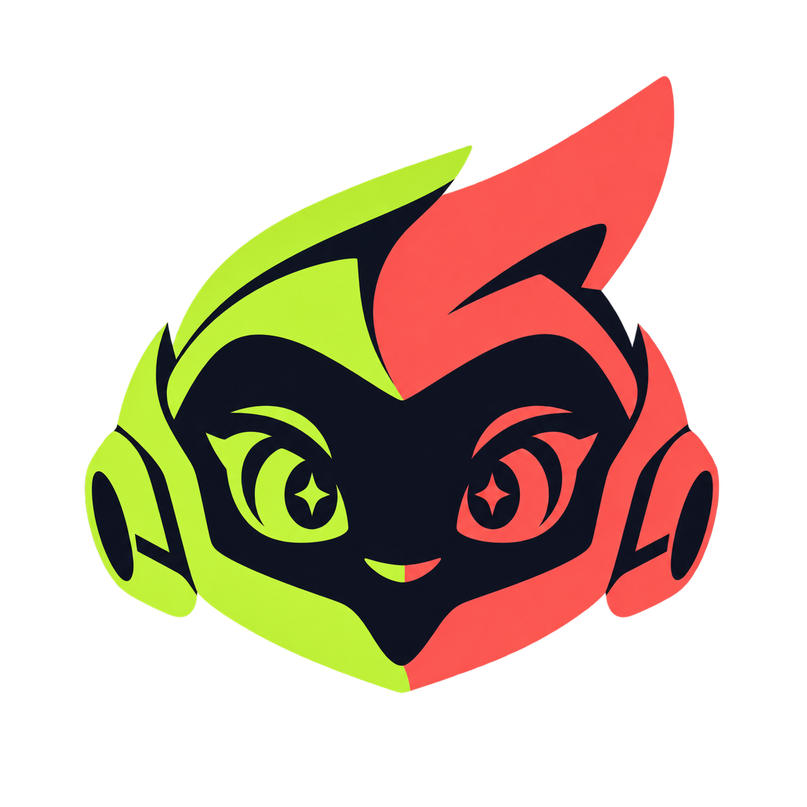

# FunAvatar

**Give your avatar a character worth remembering.**

FunAvatar is a public skill for **Codex and Claude Code**. It helps you design expressive VRChat characters, create consistent 2D modeling references, track authorized 3D production, inspect Blender/Unity projects and debug concrete avatar problems.

[Visit the website](https://funavatar.mondovr.it) · [Download a release](https://github.com/xcapsa/FunAvatar/releases/latest) · [Share feedback](https://github.com/xcapsa/FunAvatar/issues/new/choose)

## What it does

| Your starting point | What FunAvatar helps produce |
| --- | --- |
| A character idea | An identity brief, signature features and a platform/input plan. |
| A sketch or reference image | A consistent master design and labeled modeling views when an image generator is available. |
| An approved design or existing 3D export | A production ledger with hashed inputs/revisions, resumable Tripo jobs and explicit credit accounting. Manual imports need no provider account. |
| A Blender, Unity or VRChat problem | Compact native observations, a bounded reproduction plan, targeted fixes and clearly separated test evidence. |

Start with **one project and one primary chat per avatar**. Keep outfits, transformations and platform variants with the same character. Save shared conventions at project level and the approved design, assets and test evidence with that avatar.

A reference sheet is design guidance. A downloaded model is a 3D asset. A static report is an observation. Rig quality, SDK validation and behavior observed by another VRChat user each need their own checks. FunAvatar keeps these stages distinct and does not certify an avatar from a screenshot or upload it automatically.

## Install or update

Requires Python 3.10+. Installation and the core offline helper use the standard library, with no API key or background service.

```sh
git clone https://github.com/xcapsa/FunAvatar.git
cd FunAvatar
python3 install.py --target both
```

Use `--target codex` or `--target claude` for one host. The installer copies the skill to `~/.agents/skills/funavatar` for Codex and `~/.claude/skills/funavatar` for Claude Code. Invoke **`$funavatar`** in Codex or **`/funavatar`** in Claude Code. Start a new session if discovery needs refreshing.

For an existing unchanged installation:

```sh
git pull --ff-only
python3 install.py --target both --update
```

Updates verify managed file hashes, refuse unrecognized local changes and symlinks, stage both targets before replacement, and retain rollback backups outside skill discovery at `~/.local/share/funavatar/backups`. They do not change application settings. Preserve custom work before upgrading; the installer will not silently discard it.

Discovery follows the [Codex skill guide](https://learn.chatgpt.com/docs/build-skills) and [Claude Code skill guide](https://code.claude.com/docs/en/skills). A portable skill ZIP is available in releases for environments that support manual skill uploads; account support and image tools vary by host.

## Try it

> Use FunAvatar to design a curious robot explorer. Give it a recognizable silhouette, expressive eyes and one useful signature interaction. Plan PC and native Quest versions, then prepare consistent front, back and side references.

> Use FunAvatar to track my existing 3D export without calling a paid service. Preserve the original, record its revision and assess fidelity to the approved design before rigging.

> Use FunAvatar to debug a toggle that works in my mirror but not for another player. Reuse my project and report local, remote and device evidence separately.

Codex uses its built-in image generator when available. Other hosts use an available connected tool; without one, FunAvatar provides a brief and runnable prompts and leaves images pending. It does not install or charge for a provider to hide missing capabilities.

## 3D production and Tripo

The optional workflow helper supports a **manual, offline route** and explicitly authorized **Tripo API operations**. API work requires the user's provider, reference-upload scope, requested operations and numeric credit budget. Use `TRIPO_API_KEY` through the execution environment, never in a command argument or report.

`workflow.json` records input hashes, asset lineage, job/task IDs, reservations, observed charges and revision-specific checks. Submission intent is persisted before a paid request. Interrupted or ambiguous submissions are reconciled instead of automatically resubmitted. Credit reservations are local admission controls; they are not provider-enforced price caps.

The workflow adapter currently requires **macOS/Linux** because it uses Unix `fcntl` locks. Native Windows support is not implemented. This limitation is separate from an avatar's VRChat target platform.

Read the [3D workflow](skills/funavatar/references/workflow-3d.md) for exact commands, recovery, accounting and current limitations, and the [Tripo profile](skills/funavatar/references/tripo.md) for input quality and reference fidelity.

## Guides and local tools

- [Character foundations and distinctive features](skills/funavatar/references/character-design.md)
- [Concept prompts](skills/funavatar/references/prompt-recipes.md) and [visual review](skills/funavatar/references/review-rubric.md)
- [Modeling handoff and fidelity gate](skills/funavatar/references/technical-handoff.md)
- [Blender/Unity project checks](skills/funavatar/references/project-checks.md)
- [Runtime debugging](skills/funavatar/references/runtime-debug.md)

The core helper creates briefs/prompts, checks image headers and hashes, reads compact native reports and prepares unexecuted debug plans. Blender's collector runs inside Blender; Unity's collector requires the user's authorized project and supported editor. Follow the current [VRChat Unity guidance](https://creators.vrchat.com/sdk/upgrade/current-unity-version/) before choosing an editor. Helper tests do not establish deformation, PhysBones, synchronization or native-device behavior for a real avatar.

## Something went wrong, or the result does not feel right?

**Please tell us.** Technical bugs, confusing instructions and subjective avatar feedback all help improve this project.

When you tell FunAvatar that a result does not match your intent, the skill prepares a short sanitized report, shows you exactly what it proposes to share, and asks whether you want to send it. Reporting is optional; your avatar work continues either way. There is no automatic telemetry or background upload.

Reports on GitHub are **public**. Share only the relevant prompt excerpt, expected/actual result, workflow stage and useful version/platform details. Do not include credentials, private URLs, full chats, personal details or avatar files you cannot publish. A report is considered delivered only when its issue URL is returned.

[Report a reproducible bug](https://github.com/xcapsa/FunAvatar/issues/new?template=bug_report.yml) · [Share avatar or skill feedback](https://github.com/xcapsa/FunAvatar/issues/new?template=user_feedback.yml)

Italiano e English sono entrambi benvenuti.

## Example and development

[L'Infissiologo](examples/infissiologo/) is an existing Oculandia human/sloth concept example with sheets, prompts and review notes. It illustrates the concept route; it is not a tested 3D VRChat avatar. Oculandia branding is opt-in and does not apply to unrelated characters.

```sh
python3 -m unittest discover -s tests -v
```

FunAvatar adapts the smallest-complete-intervention principle from Dietrich Gebert's [Ponytail](https://github.com/DietrichGebert/ponytail/blob/main/skills/ponytail/SKILL.md). See [third-party acknowledgements](THIRD_PARTY_NOTICES.md). The repository is publicly accessible; no project-wide open-source license is currently declared.

Independent project. Not affiliated with VRChat, OpenAI, Anthropic or Tripo.
