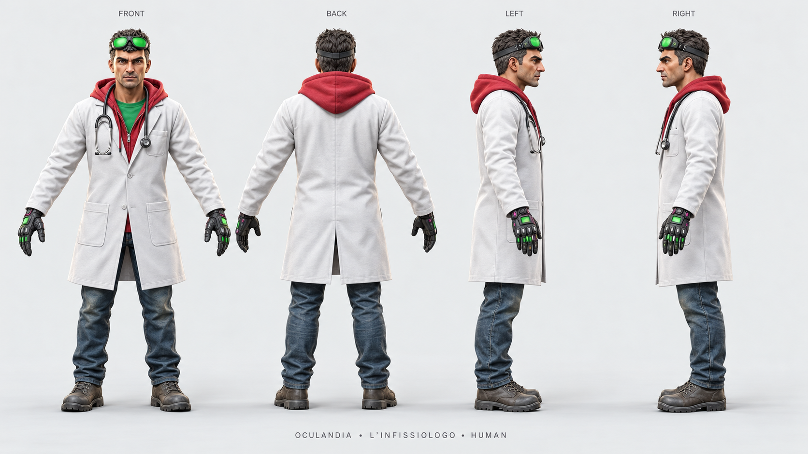
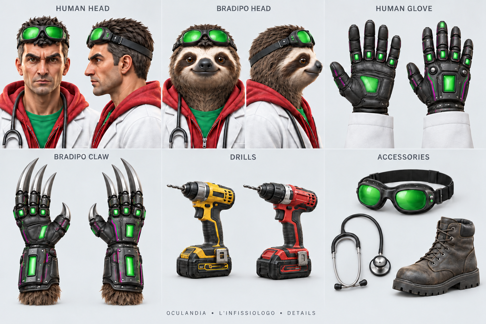

# L'Infissiologo — Oculandia

Three separate concept sheets made with the built-in image generator. The human reference establishes the face and workwear; the earlier character sheet informs the sloth transformation and mechanical gloves.

| File | Native size | Contents |
| --- | --- | --- |
| [human-turnaround.png](human-turnaround.png) | 1672 × 941 | Human front, back and both side views |
| [bradipo-turnaround.png](bradipo-turnaround.png) | 1672 × 941 | Sloth front, back and both side views |
| [details.png](details.png) | 1536 × 1024 | Heads, glove/claw surfaces, yellow and red drills, goggles, stethoscope and boot |

## Design and review

Identity anchors are the green goggles on the forehead, white coat, red hoodie, green shirt, stethoscope and workwear. The human has five digits per hand. The stylized sloth has three long mechanical finger claws plus a shorter opposable thumb; the front-view feet show three toe claws each. Drill props are separate so they do not hide the hands in the body views.

The sheets use Oculandia footer text. No Odido branding or unrelated logo is visible. No standalone original Oculandia logo asset was used.

Independent visual review checked identity, visible anatomy, cropping, outfit continuity and branding. The files are useful concept references, with these construction details left for the modeler:

- Hand panels describe palm and back surfaces; they do not establish exact left/right correspondence or identical geometry across every study.
- Overlapping feet in side views prevent an independent count of every hidden toe.
- Each sheet normalizes its own character size. Separate canvases do not establish the human-to-sloth height ratio.
- Fine glove plates, seams, concealed joints and prop attachment geometry still need a consistent 3D design.

The generator did not return the larger native sizes requested, including a 4096 × 2304 retry. These files retain the actual native output; none was resized or upscaled.

The [exact prompts and edits](prompt-set.md) are included. [Image checks](image-checks.json) record dimensions, file structure and SHA-256 checksums. Those automated checks do not decode pixels or prove visual or 3D validity.

Mesh, UVs, rig, animation and VRChat runtime validation have not been built or tested by this image workflow.
